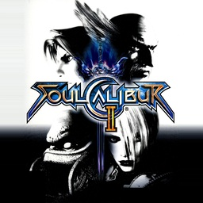

<p align="center">
  
</p>

# Soulcalibur II NX for Nintendo Switch

[](https://github.com/markaurel13/soulcalibur2-nx)
[]()
[-blue.svg)](https://github.com/fincs/deko3d)
[-purple.svg)]()
[](https://github.com/markaurel13)

A high-performance, native static recompilation port of **Soulcalibur II** (Xbox NTSC-U) for the Nintendo Switch.

Unlike traditional emulation, this port statically recompiles the original Xbox x86 game binary directly into native ARM64 machine code, paired with a purpose-built **deko3d** low-level GPU renderer and a native **audren** audio backend.

---

## ✨ Features

- **~60 FPS on Stock Clocks:** Running at full speed on Stock Clocks, both Handheld and Docked.
- **Dynamic Docked / Handheld Resolution Scaling:**
  - **Docked Mode:** Renders natively at **1920x1080 (1080p)** with hardware swapchain scaling.
  - **Handheld Mode:** Renders natively at **1280x720 (720p)**.
  - **Hot-Swap Support:** Automatically recreates the swapchain and render targets when docking or undocking mid-game.
- **Custom Low-Level `deko3d` Graphics Pipeline:**
  - Hardware D3D8 fixed-function vertex transformation, lighting, skinning, and register combiners translated to native Tegra X1 shaders.
  - Hardware BC1/BC2/BC3 (DXT1/3/5) texture decoding, mipmaps, and stencil shadow volumes.
  - Dedicated multi-core vertex/draw worker pipeline.
- **Native `audren` Audio Architecture:**
  - Dedicated audio flush worker on Core 3 (`48 kHz` stereo, 48 HW voice channels, 24 active voices) with zero dynamic voice ducking.
- **Local Multiplayer & Full Controller Support:**
  - Supports Handheld mode, Pro Controllers, dual Joy-Cons, and up to 4 players via `HidNpadStyleSet_NpadFullCtrl`.
- **In-Game FPS Overlay:**
  - Toggle the real-time FPS counter anytime with **`L + R + D-Pad Down`** or **`ZL + ZR + D-Pad Down`**.

---

## 📁 Installation (Nintendo Switch)

1. Download the latest `soulcalibur2.nro` from the [Releases](https://github.com/markaurel13/soulcalibur2-nx/releases) page.
2. Create the `/switch/soulcalibur2/` folder on your Nintendo Switch microSD card (`sdmc:/`) and place `soulcalibur2.nro` inside.
3. Copy your own legal **Soulcalibur II (Xbox NTSC-U)** game files into `sdmc:/switch/soulcalibur2/`:
   - `Default.xbe`
   - `root.olk`
   - `movie.afs`
   - `bgm.afs`

Your microSD card directory structure should look like this:

```text
sdmc:/
└── switch/
    └── soulcalibur2/
        ├── soulcalibur2.nro        # Nintendo Switch native executable (from Releases)
        ├── Default.xbe             # Original Xbox executable
        ├── root.olk                # Game assets archive
        ├── movie.afs               # FMV cutscenes
        ├── bgm.afs                 # Background music
        └── save/                   # Auto-created for save data
```

> [!TIP]
> You can also place `Default.xbe`, `root.olk`, `movie.afs`, and `bgm.afs` inside `sdmc:/switch/soulcalibur2/disc/` if you prefer keeping assets in a subfolder.

---

## 🎮 Controls & Shortcuts

Standard Nintendo Switch controller mapping (Xbox face buttons mapped positionally: **B** = A, **A** = B, **Y** = X, **X** = Y, **Plus (+)** = Start, **Minus (-)** = Back).

| Shortcut | Action |
| :--- | :--- |
| **`L + R + D-Pad Down`** *(or `ZL + ZR + D-Pad Down`)* | Toggle in-game FPS overlay |
| **`L + R + D-Pad Up`** | Toggle GPU / CPU vertex pipeline |

---

## 🛠️ Building from Source

### Prerequisites
- [devkitPro](https://devkitpro.org/) with `devkitA64`, `libnx`, `deko3d`, `uam`, `cmake`, and `ninja`
- Python 3 (for lifting the Xbox executable)

### 1. Extract & Lift the Game Binary
Place your clean Xbox NTSC-U dump files (`Default.xbe`, `root.olk`, `movie.afs`, `bgm.afs`) into `private/disc/` and run:

```bash
python3 tools/build_game.py lift
```

### 2. Build `soulcalibur2.nro`
```bash
cmake -S switch -B build/switch -DCMAKE_TOOLCHAIN_FILE=/opt/devkitpro/cmake/Switch.cmake -G Ninja
cmake --build build/switch --target soulcalibur2_nro
```

The compiled executable will be generated at `build/switch/soulcalibur2.nro`.

---

## 🙏 Credits & Upstream

- **Upstream Recompilation Project:** [tmcleroy/soulcalibur2-recomp](https://github.com/tmcleroy/soulcalibur2-recomp)
- **Switch Graphics API:** [fincs/deko3d](https://github.com/fincs/deko3d)
- **Toolchain & SDK:** [devkitPro / libnx](https://github.com/switchbrew/libnx)

---

## ⚖️ Legal Notice

This repository contains **no copyrighted game assets, ROMs, XBEs, or binary data**. You must supply your own legally obtained copy of **Soulcalibur II (Xbox NTSC-U)** to run or build this project.
