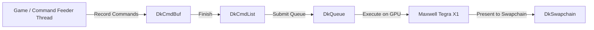

# Deko3D Master Low-Level Renderer Guide

A comprehensive technical reference for building high-performance Nintendo Switch renderers using **Deko3D** (`deko3d`), devkitPro's low-level, bare-metal C API for the Nvidia Tegra X1 Maxwell GPU.

---

## 1. Why Deko3D Over Mesa / OpenGL / Vulkan?

Comparative metrics from production recompilation ports (**MKDD-NX**, **NFSMW-NX**, **SA2-NX**, **Renut-NX**):

| Feature | Mesa (Gallium Nouveau / OpenGL ES) | Deko3D (Native Bare-Metal API) |
|---|---|---|
| **CPU Render Overhead** | 5 – 9 ms per frame | **1.5 – 2.5 ms per frame** |
| **GPU Latency** | High overhead from driver state tracking | Zero driver abstraction overhead |
| **Frame Hitching / Stutters** | Common on runtime GLSL compilation | None (AOT compiled `.dksh` shaders) |
| **Binary Footprint** | Adds ~50 MB to executable size | Lightweight static library |
| **Stock Clock Viability** | Frequently requires overclocking | **Solid 60 FPS on stock 307 MHz GPU** |

---

## 2. Deko3D Architecture Overview

Deko3D closely mirrors modern explicit APIs (Nvidia NVN, Vulkan, Direct3D 12):



### Core Concepts:
- **`DkDevice`**: Represents the Tegra X1 GPU device instance.
- **`DkQueue`**: The hardware submission queue (supports graphics and compute work).
- **`DkMemPool`**: Explicit GPU memory allocation block. All buffers, textures, command lists, and shaders live inside memory pools.
- **`DkCmdBuf`**: Command buffer recorded on the CPU.
- **`DkCmdList`**: Compiled sequence of GPU commands submitted to the queue.
- **`DkSwapchain`**: Manages the screen backbuffers presented to Horizon OS.
- **`DkShader`**: AOT-compiled binary shader (`.dksh`).
- **`DkFence`**: GPU-to-CPU / GPU-to-GPU synchronization primitive.

---

## 3. Initialization & Setup

### 3.1 Device & Queue Creation
```c
DkDeviceMaker devMaker;
dkDeviceMakerDefaults(&devMaker);
DkDevice device = dkDeviceCreate(&devMaker);

DkQueueMaker queueMaker;
dkQueueMakerDefaults(&queueMaker);
queueMaker.device = device;
queueMaker.flags = DkQueueFlags_Graphics;
DkQueue queue = dkQueueCreate(&queueMaker);
```

### 3.2 Memory Pool Types & Flags
Memory pools must be allocated with appropriate properties:

| Pool Use | `DkMemPoolFlags` | Usage |
|---|---|---|
| **Shaders** | `DkMemPoolFlags_Code | DkMemPoolFlags_Gpu` | Executable GPU code |
| **Command Buffers** | `DkMemPoolFlags_CpuAccess | DkMemPoolFlags_Gpu` | Dynamic command recording |
| **Uniform Buffers** | `DkMemPoolFlags_CpuAccess | DkMemPoolFlags_Gpu | DkMemPoolFlags_CpuUncached` | Per-frame dynamic uniforms |
| **Textures / Images** | `DkMemPoolFlags_Gpu | DkMemPoolFlags_Image` | VRAM texture storage |
| **Render Targets** | `DkMemPoolFlags_Gpu | DkMemPoolFlags_Image` | Framebuffer color/depth |

Allocation pattern:
```c
DkMemPoolMaker poolMaker;
dkMemPoolMakerDefaults(&poolMaker);
poolMaker.device = device;
poolMaker.size = poolSize;
poolMaker.flags = DkMemPoolFlags_CpuAccess | DkMemPoolFlags_Gpu;
DkMemPool memPool = dkMemPoolCreate(&poolMaker);
```

---

## 4. Framebuffers & Swapchain

### Swapchain Configuration (Double / Triple Buffering):
```c
#define NUM_FRAMEBUFFERS 2
DkImage framebufferImages[NUM_FRAMEBUFFERS];
DkImageView framebufferViews[NUM_FRAMEBUFFERS];

DkSwapchainMaker swapchainMaker;
dkSwapchainMakerDefaults(&swapchainMaker);
swapchainMaker.device = device;
swapchainMaker.nativeWindow = nwindowGetDefault();
swapchainMaker.pImages = framebufferImages;
swapchainMaker.numImages = NUM_FRAMEBUFFERS;
DkSwapchain swapchain = dkSwapchainCreate(&swapchainMaker);
```

### Frame Loop Synchronization:
1. Acquire next framebuffer index:
   ```c
   int slot = dkQueueAcquireImage(queue, swapchain);
   ```
2. Bind target attachments:
   ```c
   dkCmdBufBindRenderTargets(cmdbuf, &framebufferViews[slot], 1, &depthStencilView);
   ```
3. Record rendering commands into `cmdbuf`.
4. Finish command list and submit:
   ```c
   DkCmdList cmdList = dkCmdBufFinishList(cmdbuf);
   dkQueueSubmitCommands(queue, cmdList);
   ```
5. Present image to display:
   ```c
   dkQueuePresentImage(queue, swapchain, slot);
   ```

---

## 5. Shaders & The `.dksh` Pipeline

Deko3D does not accept runtime GLSL source text. Shaders are compiled offline or dynamically ahead-of-time using `uasm` / Deko3D shader tools:

1. **Source Shader**: GLSL or NVN assembly.
2. **Compiler Tool**: `uasm` generates `.dksh` header and Maxwell control codes.
3. **Loading into Memory**:
   - Shaders must reside inside a memory pool created with `DkMemPoolFlags_Code`.
   - The memory address must be 256-byte aligned.

```c
DkShaderMaker shaderMaker;
dkShaderMakerDefaults(&shaderMaker, shaderPool, shaderPoolOffset);
DkShader vertexShader = dkShaderCreate(&shaderMaker);
```

### Binding Pipelines:
```c
dkCmdBufBindShaders(cmdbuf, DkStageFlag_GraphicsMask, shaders, numShaders);
```

---

## 6. Descriptors: Textures & Samplers

Deko3D uses bindless texture and sampler descriptors stored in memory pools:
- **`DkImageDescriptor`**: Contains format, dimensions, mip count, GPU address.
- **`DkSamplerDescriptor`**: Contains wrap mode, filtering (bilinear/trilinear/anisotropic), LOD clamp.

```c
// Initialize Sampler
DkSampler sampler;
dkSamplerDefaults(&sampler);
sampler.minFilter = DkFilter_Linear;
sampler.magFilter = DkFilter_Linear;
sampler.mipFilter = DkMipFilter_Linear;
sampler.maxAnisotropy = 16.0f;

// Write descriptor into sampler descriptor set table
dkSamplerDescriptorInitialize(&samplerDesc, &sampler);
```

---

## 7. Key Optimization Lessons from Community Ports

1. **Pre-allocate Ring Buffers for Dynamic Uniforms**:
   - Never call `malloc` or allocate memory during the render loop.
   - Use double-buffered or ring-buffered linear memory pools for uniform buffers, advancing an offset each frame and resetting on frame completion.
2. **State Caching**:
   - Redundant state changes (blend modes, rasterizer state, depth stencil tests) are CPU waste. Cache current state on the CPU feeder thread and only emit commands when state truly changes.
3. **Batch Small Draw Calls**:
   - In titles like Katamari or Sonic Adventure, thousands of tiny draw calls saturate the CPU. Batch static geometry into indexed vertex buffers or instanced draw calls where possible.
4. **Fast Memory Clears**:
   - Use `dkCmdBufClearColor` and `dkCmdBufClearDepthStencil` rather than drawing full-screen quads for clearing backbuffers.
