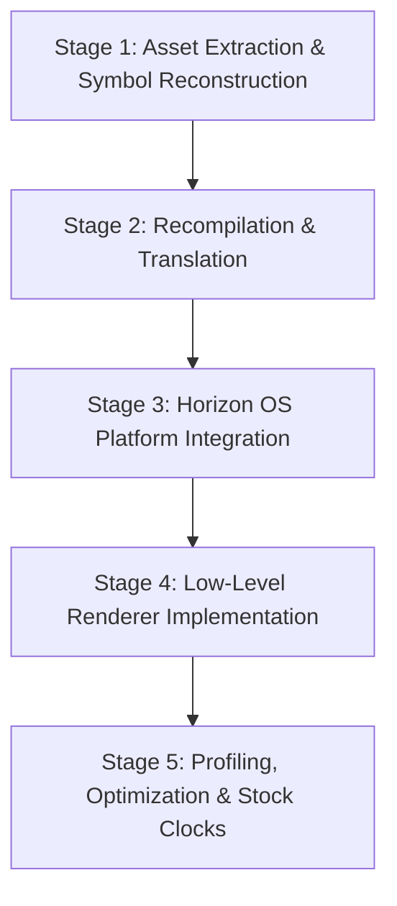

# Master Static Recompilation & Porting Playbook

A technical architectural guide for porting console and PC games to Nintendo Switch using static recompilation, low-level rendering, and Horizon OS native integrations.

---

## 1. Static Recompilation Paradigms

Static recompilation (Recomp) translates machine code from an original target ISA into native C/C++ or AArch64 machine instructions ahead of time (AOT). Unlike emulators, there is no CPU interpreter loop or JIT runtime compilation overhead during gameplay.

### Supported Platforms & Toolchains
1. **Xbox 360 (PowerPC Xenon 64-bit Big-Endian)**:
   - Toolchains: **ReXGlue**, **360tools** (`sp00nznet/360tools`), **renut-nx**, **sa2-nx**.
   - Characteristics: 3 dual-threaded PowerPC cores (6 hardware threads) @ 3.2 GHz, VMX-128 SIMD vector registers, Big-Endian, Unified Memory Architecture (UMA) with 512 MB GDDR3, Xenos GPU (Adreno / ATI architecture).
2. **GameCube / Wii (PowerPC Gekko / Broadway 32-bit Big-Endian)**:
   - Toolchains: **N64/GC Recomp** toolchain, **mkdd-nx** (`digdat0/mkdd-nx`), **SwitchWakerHD** (`centollOS/SwitchWakerHD`), **ACGC** (`digdat0/ACGC-Switch-Port`).
   - Characteristics: 32-bit PPC Gekko @ 485 MHz, paired single (PS) SIMD float instructions, Flipper / Hollywood GX GPU.
3. **Original Xbox (x86 32-bit Little-Endian)**:
   - Toolchains: **xboxrecomp** (`sp00nznet/xboxrecomp`).
   - Characteristics: Intel Pentium III @ 733 MHz, NV2A GPU (DirectX 8.1 API).
4. **PC / Native C/C++ Source Ports**:
   - Clean engine ports (e.g. Classic PC games, OpenMW, ioquake3, mono-nx, switch-gdx).

---

## 2. The Multi-Stage Porting Pipeline

Every port follows a structured five-stage engineering pipeline:

### Stage 1: Asset Extraction & Symbol Reconstruction
- Extract game discs/packages (ISO, XBE, XEX, WAD, GC GCM/ISO).
- Demangle symbols, export functions, generate symbol address maps (`.map`, `.sym`, Ghidra export).
- Map endianness requirements:
  - GameCube & Xbox 360 binaries execute big-endian code and data.
  - Nintendo Switch ARM64 (Cortex-A57) executes little-endian.
  - Endianness handling is resolved either via runtime byte swapping macros (`__builtin_bswap32`, `__builtin_bswap64`) or virtual memory translation layers.

### Stage 2: Code Generation & Runtime Stubs
- Use the recompiler to generate C/C++ files from binary functions.
- Stub or implement platform SDK calls:
  - **Xbox / 360**: XAPI, Direct3D (D3D9/D3D8), XAudio2, DirectSound, XInput, Kernel (`KeGetCurrentProcessType`, `NtCreateFile`, `KeSetEvent`).
  - **GameCube**: Dolphin OS (`OSInit`, `OSCreateThread`, `DVDOpen`), GX graphics API (`GXBegin`, `GXSetVtxDesc`), AX audio (`AXInit`).
- Function hooking & replacement:
  - Maintain a registry to intercept specific hot functions and substitute them with native ARM64 or handwritten C/C++ routines.

### Stage 3: Horizon OS System Integration
- Virtual File System (VFS) & RomFS:
  - Horizon OS paths are case-sensitive and use POSIX slashes (`/`).
  - Implement a transparent case-folding wrapper for asset lookups (e.g., Windows/Xbox path translation `\` $\rightarrow$ `/`).
- Input & Controls:
  - Map `PadState` / `hid` to game inputs.
  - Integrate controller applet for player 1–4 detachment and reconnection.
- User Storage / Saves:
  - Mount user save data containers using `fsdevMountSaveData`.

### Stage 4: Renderer Architecture (Deko3D)
- Decouple the legacy graphics calls (GX, NV2A, or Direct3D9 microcode) into a platform-agnostic command queue.
- Translate rendering state, shader pipelines, and vertex layouts into native **deko3d** commands.
- See [DEKO3D_MASTER_RENDERER_GUIDE.md](file:///home/mark/Proyectos/soulcalibur2_nx/guides/DEKO3D_MASTER_RENDERER_GUIDE.md).

### Stage 5: Profiling & Optimization
- Enable sampling profiler (`perfil_pilas.flag`).
- Target 60 FPS (or rock-solid 30 FPS) at stock clock speeds (1020 MHz CPU, 307 MHz GPU handheld).
- Eliminate memory allocation in hot loops.
- Apply Link-Time Optimization (`-flto`) and Profile-Guided Optimization (`-fprofile-generate` / `-fprofile-use`).

---

## 3. Threading Architecture on Nintendo Switch

Nintendo Switch features 4 Cortex-A57 cores:
- **Core 0**: Operating system / background services.
- **Cores 1, 2, 3**: Available to applications (or all 4 cores with 4-core mode enabled in modern libnx environments).

### Thread Allocation Strategy:
| Core | Recommended Assignment |
|---|---|
| **Core 1** | Main Game Logic / Recompiled CPU Thread |
| **Core 2** | Render / GPU Command Processor Thread (Deko3d feeder) |
| **Core 3** | Audio Thread (audren/SDL2) + Asynchronous Asset Streaming / IO |

### Thread Synchronization Patterns:
- Prefer lock-free ring buffers or lightweight mutexes (`mutexLock`, `mutexUnlock` from libnx or `std::atomic`).
- Avoid frequent thread preemption or busy-spinning without yielding (`armYield()`).
- Keep command buffer generation on the GPU feeder thread decoupled from game tick logic.

---

## 4. Porting Checklist & Best Practices

- [ ] **Check Path Separators**: Never assume backslashes (`\`). Normalize paths to forward slashes (`/`).
- [ ] **Case Sensitivity**: Switch SD card and RomFS may be case-sensitive depending on the filesystem. Always normalize or provide case-insensitive fallback logic.
- [ ] **Memory Alignment**: ARM64 strictly penalizes unaligned memory accesses (and can fault on unaligned vector loads). Ensure vertex buffers and structs are 4-, 8-, or 16-byte aligned.
- [ ] **Float Denormals & Rounding**: Ensure FPCR (Floating-point Control Register) matches original console behavior (flush-to-zero / denormal handling if required by physics engines).
- [ ] **No Mandatory Overclocking**: Profile under stock handheld clocks to ensure broad compatibility and battery efficiency.
