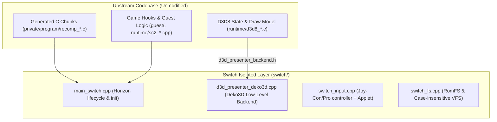

# Switch Port Documentation & Architecture

This directory contains the entire Nintendo Switch platform adaptation layer for **Soulcalibur II Recomp**, completely isolated from the upstream desktop/Android codebase.

---

## 🏗️ Architecture & Isolation Strategy

To prevent any merge conflicts or entanglement when the upstream repository (`tmcleroy/soulcalibur2-recomp`) pushes new releases, this port strictly adheres to the **Modular Decoupling Pattern**:



1. **No `#ifdef __SWITCH__` in Core Files**:
   Upstream files (`runtime/`, `guest/`, `third_party/doa2u-re`) remain standard.
2. **Pluggable Graphics Backend**:
   `d3d_presenter_deko3d.cpp` exports the exact C symbols declared in `d3d_presenter_backend.h` (`d3d_backend_create`, `d3d_backend_submit`, `d3d_backend_destroy`, etc.).
3. **Dedicated Build Target**:
   `switch/CMakeLists.txt` builds the `.elf` and packages `soulcalibur2.nro` using devkitA64 (`elf2nro`).

---

## 🔄 The Upstream Update Workflow (Zero Merge Conflicts)

When the upstream author publishes an update (e.g. `v0.4.1`, `v0.5.0` with new costumes, audio improvements, or gameplay fixes):

### How to update safely in 3 commands:
```bash
# 1. Fetch latest changes from official upstream
git fetch upstream

# 2. Rebase your switch-port branch onto upstream/main
git rebase upstream/main

# 3. Update submodules to pinned commits
git submodule update --init --recursive
```

Because **99% of Switch files exist only inside `switch/`**, Git will rebase cleanly without touching your platform layer!

---

## 🚀 Execution & Porting Roadmap

### Phase 1: Game Extraction & Code Lifting (PC Linux)
1. Place your clean Xbox USA disc dump into `private/disc/`:
   - `private/disc/Default.xbe`
   - `private/disc/root.olk`
   - `private/disc/movie.afs`
   - `private/disc/bgm.afs`
2. Run the lifter tool:
   ```bash
   python3 tools/build_game.py lift
   ```
   This disassembles the x86 machine instructions and emits standard C files in `private/program/` (`recomp_0000.c` ... `recomp_XXXX.c`).

### Phase 2: Build the Switch NRO
Configure and build using the devkitPro toolchain:
```bash
mkdir -p build/switch
cd build/switch
cmake ../../switch -DCMAKE_TOOLCHAIN_FILE=/opt/devkitpro/cmake/Switch.cmake -G Ninja
ninja
```
This produces `soulcalibur2.nro`.

### Phase 3: RomFS / SD Card Asset Placement
On your Switch SD card:
```
sdmc:/switch/soulcalibur2/
├── soulcalibur2.nro
└── romfs/
    ├── root.olk
    ├── movie.afs
    └── bgm.afs
```

### Phase 4: Multiplayer & Performance
- Supports single Joy-Con horizontal play, dual Joy-Cons, and Pro Controllers.
- Press **Plus (+)** or navigate to VS Battle to trigger the controller pairing applet.
- Target: Solid 60 FPS in Handheld (1020 MHz CPU / 307 MHz GPU) and Docked (768 MHz GPU).
